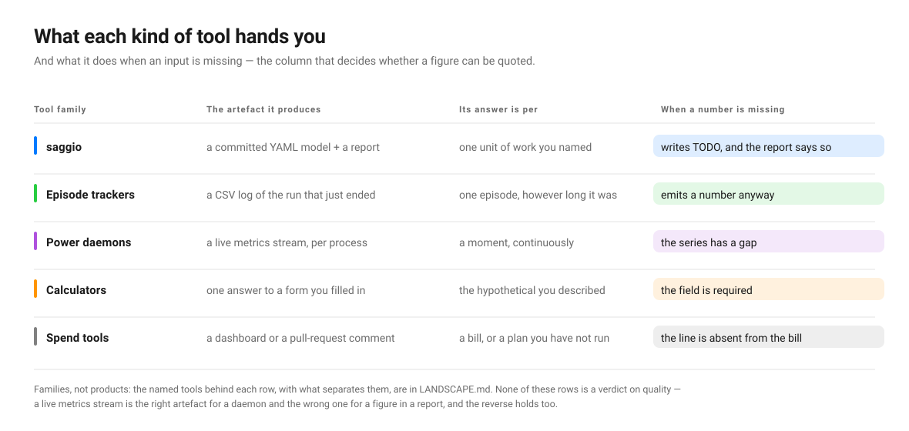

# Gallery

[🇫🇷 GALERIE.md](GALERIE.md) · 🇬🇧 English

Cost models this tool produced, on repositories you can go and read. Every file
under [`examples/`](examples/) was generated by the command printed above it,
each committed with the report rendered beside it.

**None of these is a cost claim.** They are what `saggio audit` writes before a
human has touched anything: a model whose expensive numbers are still open,
whose unit of work is a proposal, whose machine is the one that ran the audit
rather than the one the code runs on. That last point matters most here, because
these repositories were cloned and read on a laptop. Each model says so, in
`deployment.machine_provenance`. The value of the gallery is not the numbers. It
is seeing what the tool establishes, what it refuses to establish, and where it
gets things wrong.

Regenerate any of them:

```bash
saggio audit https://github.com/karpathy/nanoGPT --country FR --no-llm -o examples/nanoGPT.yaml
saggio render examples/nanoGPT.yaml -f md -o examples/nanoGPT.md
```

## The eight repositories

| Model | Repository | What it was read as | The interesting part |
|---|---|---|---|
| [`nanoGPT`](examples/nanoGPT.yaml) · [report](examples/nanoGPT.md) | `karpathy/nanoGPT` | training | Two disagreements about how long a run is, both reported |
| [`whisper`](examples/whisper.yaml) · [report](examples/whisper.md) | `openai/whisper` | command-line tool | Nothing invented: no model, no service, no run length |
| [`dinov2`](examples/dinov2.yaml) · [report](examples/dinov2.md) | `facebookresearch/dinov2` | training | Seven files disagree about how long a run is |
| [`fastapi`](examples/fastapi.yaml) · [report](examples/fastapi.md) | `fastapi/fastapi` | command-line tool | Its test suite is told apart from its code |
| [`airflow`](examples/airflow.yaml) · [report](examples/airflow.md) | `apache/airflow` | service | Nine languages, eight paid services, thirty-six models |
| [`saggio`](examples/saggio.yaml) · [report](examples/saggio.md) | this repository | command-line tool | Everything it appears to call, it calls only in tests |
| [`detectron2`](examples/detectron2.yaml) · [report](examples/detectron2.md) | `facebookresearch/detectron2` | inference | The first example read as inference, and nothing invented to fill it |
| [`xberg`](examples/xberg.yaml) · [report](examples/xberg.md) | `xberg-io/xberg` | service | Fourteen languages, only 3.6% of it Python |

### nanoGPT — the size of a run is not one number

Read as a **training** workload importing PyTorch, transformers and NumPy. A
full run is `600000` iterations, from `train.py::max_iters`. Three other files
in the same repository say something else, which the model reports rather than
settling:

> `max_iters` is stated more than once and the statements disagree
> (`train.py` says 600000; `config/finetune_shakespeare.py` says 20;
> `config/train_gpt2.py` says 600000; `config/train_shakespeare_char.py` says
> 5000). `train.py::max_iters` was used; check it is the one a real run reads.

That sentence is the product. A tool that quietly picked one would be off by a
factor of thirty thousand on the character-level config, and nobody would know.

### whisper — read correctly, and nothing added

Read as a **command-line tool** importing PyTorch, NumPy and ffmpeg, which is what
Whisper is. No paid service, no model identifier, no run length: Whisper's code
states none of them, so the model states none of them either.

That empty answer took a fix to get. An earlier version of this page reported a
model called `Whisper`, from `whisper/decoding.py:20`:

```python
model: "Whisper", mel: Tensor, tokenizer: Tokenizer = None
```

That is a type annotation in a function signature. Python has no unquoted
mapping keys, so a colon after a bare name is an annotation and never a model
being chosen. The detector now knows the difference, and the line above finds
nothing.

### dinov2 — the tool picked one, and says to check it

Read as **training**, and as compute-bound, which licenses the accelerator
projection. Seven files state an epoch count and they disagree: the training
configs say 400 and 500, the SSL (self-supervised learning) default says 100,
the evaluation scripts say 10 and 30. It goes with
`configs/train/cell_dino/vitl16_boc_hpafov.yaml`, listing the other six.

It used to go with `configs/eval/...`, an *evaluation* config, because the rule
was alphabetical and `eval` sorts before `train`. A repository that separates
`configs/train` from `configs/eval` is telling you which of the two a real run
reads, so the rule now listens: a training directory outranks a neutral one,
which outranks an evaluation, benchmark or example one.

Among four training configs it is still alphabetical, and 400 against 500 is a
real ambiguity this cannot settle. What it does instead is name the file it used
and the six it did not, so the question takes one glance to find.

### fastapi — the suite is not the workload

Read as a **command-line tool**, 1138 Python files, no compute framework. It
finds three model identifiers, all three arriving with a caveat:

```yaml
- model: alexnet
  detected_at: tests/test_tutorial/test_path_params/test_tutorial005.py:12
  caveat: Found only in the code that tests this repository, so it may not be part
    of the workload. Confirm before pricing it.
```

`alexnet`, `lenet` and `resnet` are strings in a tutorial test. They are
reported, because dropping them silently would be its own kind of dishonesty;
and flagged, because FastAPI does not call them.

There used to be a fourth, `Body_`, from `model_name = "Body_" + name` in
FastAPI's own internals. A string literal with a `+` against it is a fragment
being built, not a model being named, which the detector now says.

### airflow — the stress test

Nine languages. 7920 Python files, 1112 TypeScript, with Go, Kotlin, Java,
Shell, JavaScript and Scala behind them. Eight paid services detected with the
line that proves each one, from `providers/anthropic/.../operators/agent.py:36`
to `providers/sendgrid/.../emailer.py:28`. Thirty-five model identifiers, from
`claude-opus-4-8` to `bedrock:us.anthropic.claude-opus-4-5`, each with the line
that names it.

No size of a run: nothing in Airflow states one, so `total_work` is absent rather
than guessed. That is the right answer for an orchestrator, which has no run
length of its own.

### saggio — auditing itself

Everything this package appears to call, it calls only in its own tests: one
service and three model identifiers, all four carrying the caveat. Its single
framework, `ffmpeg`, comes from the quoted key `"ffmpeg"` in its own detector
table. A repository containing detection tables detects itself, which is inherent
and is said rather than hidden.

Its run length, `num_samples: 5000`, comes from
`examples/walkthrough/counter/config.py` — the toy repository further down this
page. Nothing else in this package states how much work a run performs, so the
only statement wins. It is the right answer to the question as asked and the
wrong answer to the question meant, which the model names the file so the
difference is one line away.

### detectron2 — the first one read as inference

Read as **inference**, which no earlier example was. The six before it covered
training twice, a service once and a command-line tool three times, so the
archetype that matters most to anyone pricing a request had never been
exercised. 497 Python files alongside C, C++ and Shell; PyTorch and NumPy found,
nothing else claimed.

What is worth looking at is how much of this model is open. No entry point was
found, so there is no run to time; no model identifier and no paid service are
named, so there is nothing to price; the work size is unstated, so the run
length stays `TODO`. A tool keen to look useful would have filled those from the
model zoo in the documentation. This one reports an empty hand, which is the
honest reading of a detection *framework*: what it costs depends entirely on
which model you point it at, and the repository does not choose for you.

### xberg — fourteen languages, and Python is 3.6% of it

Every other example in this gallery is a Python repository. This one is
[xberg](https://github.com/xberg-io/xberg) — formerly Kreuzberg, which is what
the redirect still says — a document-intelligence engine whose core is Rust with
bindings for fifteen languages. The reader finds 2,278 Rust files, 435 Java, 400
C#, 391 Kotlin and 143 Python, and reports it as mixed rather than reducing it
to whichever language has most files. That is the claim
[`LANDSCAPE.md`](LANDSCAPE.md) makes about breadth, demonstrated on a repository
that could have embarrassed it.

**It also broke two things, both since fixed.** The suite-detection rule was
Python- and JavaScript-shaped: `tests/`, `test_*.py`, `*.test.ts`. Rust puts its
tests in a *file* called `tests.rs`, so ten model identifiers named `test-model`
and `mock-model` arrived with no caveat at all. The rule now recognises a suite
in whatever language it is written, and refuses `latest.rs` and `contest.py`,
which a looser first attempt swept up.

**And one that is not fixed, named here rather than hidden.** Rust keeps unit
tests *inside* the file they test, in a `#[cfg(test)] mod tests` block.
File-level detection cannot see that, so fixtures like `trusted/model` and
`gpt-test` still appear beside the genuine `openai/gpt-4o` and
`anthropic/claude-sonnet-4-20250514` that this engine really does call. Reading
inside a file for an inline test module is a different and larger job than
reading its name.

## Three models that are finished

Everything above is an audit with nothing run: eight repositories read, eight
models whose every cost is a `TODO`. That is the honest output of reading code
you have not executed, and it is also half a demonstration. These three are the
other half — the same tool on work that was actually measured, on one machine,
with the country stated.

| Model | Unit of work | Time | Carbon | What stayed open |
|---|---|---|---|---|
| [`render`](examples/render.yaml) · [report](examples/render.md) | one HyperText Markup Language (HTML) report rendered | 0.0272 s, measured | 8.34e-06 gCO2e, estimated | water, market-based scope 2, embodied |
| [`request`](examples/request.yaml) · [report](examples/request.md) | one `/scopes` request handled end to end | 0.00385 s, measured | 1.19e-06 gCO2e, estimated | water, market-based scope 2, embodied |
| [`uncertainty`](examples/uncertainty.yaml) · [report](examples/uncertainty.md) | the same request, with the grid intensity scored | 0.00385 s, measured | 1.19e-06 gCO2e (9.76e-07 – 1.45e-06), estimated | water, market-based scope 2, embodied |

**The third row is the second one again, with its uncertainty carried.** The
grid intensity there is scored on the pedigree matrix — how reliable the
source, how complete, how recent, how close in place and in technology — and
those scores give it an interval instead of a point. The carbon figure then
*has* to carry an interval, and the one it carries is not a judgement: it is
what the arithmetic leaves once an input stops being a single number. Take the
interval off and the model fails, which is the whole of the idea.

The first two were measured on an Apple M2 Max, twelve cores, in France, by
running the work many times inside one interpreter — fifty renders, two hundred
requests —
so that Python's start-up, which is not the work, is not charged to it. The
power is a counter reading rather than a datasheet: **17.9 W** during the
renders and **18.0 W** during the requests. The nameplate this package would
otherwise have assumed is 83.76 W.

**And those watts are the machine's, not the run's.** A counter meters
hardware, not processes, so a figure read while a slice runs includes whatever
else the machine was doing. The `render` model records what that was: the
machine was already drawing **13.6 W** before the slice started, and by the
run's **21.9% share** of the machine's processor work, **3.44 W** of the 17.9 W
is attributable to it. The costs in the table use neither — they use the whole
17.9 W, which is the only figure a meter can actually see. Each of those
numbers is in the model, in the sentence attached to the power figure and in
the exclusions list beside it.

**And one run of it bounds nothing.** `render` was measured with `--repeat 5`.
The five runs disagree in a way the two figures do not share:

| | Range over five runs | Spread |
|---|---|---|
| Runtime | 1.31 s to 1.371 s | **4.5%** |
| Measured power | 15.25 W to 23.16 W | **49%** |
| Attributed by processor work | 3.209 W to 3.646 W | **13%** |

The runtime is a property of the work. The wattage is a property of the room —
a counter cannot tell what else the machine is doing apart from the work. The
third row is the one worth noticing: **attributing by processor work is the
steadiest of the three**, and the page on measuring says what follows from
that. The model carries the run whose runtime
was the median and states the range beside it; a sixth measurement is free to
land anywhere inside. **Nothing was discarded to make this look better.**

The `request` model was measured once, before `--repeat` existed, and says so
in its own notes rather than leaving the silence to read as stability.

**What "finished" means here, and what it does not.** Four of seven numbers are
established and three are still open: that is the end state rather than an
unfinished one. Water stays open because no water usage effectiveness is
published for a laptop. The market-based half of scope 2 stays open because it
rests on an electricity contract, which is a fact about an organisation and not
about this code. Embodied carbon stays open because the hardware's lifetime is a
fact about a fleet. **None of the three can be closed by measuring harder** —
each needs somebody to state something, and each says so in its own notes.

The difference from the eight above is the one worth looking at: a measured
runtime turns three `TODO`s into figures through the derivation chain, while the
power figure moves from a datasheet guess to a counter reading nearly five times
smaller — one that says how much of itself was this run, and how much it would
move if you took it again.

## The walkthrough: one workload, four stages

[`examples/walkthrough/`](examples/walkthrough/) takes one tiny repository from
nothing to a committed model, in the order a maintainer actually does it.

| Stage | File | What changed |
|---|---|---|
| 1 | [`1-as-read.yaml`](examples/walkthrough/1-as-read.yaml) | The audit, without running anything. Every cost is `TODO`. |
| 2 | [`2-measured.json`](examples/walkthrough/2-measured.json) | A real `saggio measure` run over a 500-sample slice. |
| 3 | [`3-measured.yaml`](examples/walkthrough/3-measured.yaml) | The measurement folded in, and a whole run projected from it. |
| 4 | [`4-diff.txt`](examples/walkthrough/4-diff.txt) | What `saggio diff` reports between the first and the third. |
| 5 | [`5-run.yaml`](examples/walkthrough/5-run.yaml) | `saggio audit --run --scaling-steps 3`: reading, measuring and fitting in one command. |

```bash
saggio audit examples/walkthrough/counter --country FR --no-llm -o examples/walkthrough/1-as-read.yaml
saggio measure --no-profile --json --into ../3-measured.yaml --units 500 -- python predict.py --num_samples 500
saggio diff examples/walkthrough/1-as-read.yaml examples/walkthrough/3-measured.yaml
```

Stages two and three come out of the same command. `--into` writes the measured
runtime into the model and recomputes everything that derives from it, which is
the part nobody gets right by hand: pasting a runtime into a YAML (YAML Ain't Markup Language) file leaves the
energy, the money and the carbon holding their old values, and a model whose
energy no longer matches its runtime is worse than one that had neither, because
it looks finished. `--units 500` says the command performed five hundred units of
work, so the recorded figure is per unit. `saggio audit --run` does the reading
and the running in one step instead, and asks for consent first, because that path
executes the repository's own code.

The lesson is in the diff, whose first line is the one to read twice:

```
assumptions.power_draw: 83.76 -> 31.1047 (-62.9%), estimated -> measured
assumptions.machine_energy: no number -> 1.141e-08, TODO -> measured
scenarios[0].runtime: no number -> 0.00132057, TODO -> measured
scenarios[0].costs.energy: no number -> 2.03e-08, TODO -> estimated
```

**A datasheet said 83.76 W. The counter said 31.10 W.** The nameplate was wrong
by a factor of two and a half for this workload, which is the whole argument for
reading a counter rather than a specification — and the figure only moved because
the machine would answer, which it does on Linux and on Apple Silicon.

Then the rule computes itself, in four steps anybody can follow. The runtime is
`measured`, because a stopwatch was held around it. The power is `measured`,
because a counter was read. The **machine** energy is therefore `measured` too,
with no decision taken by anybody: both of its inputs are. And the **facility**
energy is `estimated`, because it is the machine energy multiplied by a datacenter
overhead that nobody here measured. The weakest-link rule is not a policy applied
afterwards; it is what the arithmetic produces.

Stage five does the same thing in one command, and is the more interesting file
of the two because of what it refuses:

```bash
saggio audit examples/walkthrough/counter --country FR --no-llm --run --scaling-steps 3 \
  -o examples/walkthrough/5-run.yaml
```

> The work grew more slowly than the size, by a power of 0.69. Over these sizes
> the run is dominated by costs that do not grow with the job — start-up,
> imports, loading a model — so the slices are mostly measuring overhead and a
> projection from them would overstate the whole run.

That exponent is `measured`, over the three sizes that were run, with an R² of
0.999. It is also *bad news about the measurement*, which is the point: a slice
this small is mostly Python starting up, and the tool says so rather than
projecting from it with a straight face.

## The same work, through the other tools

The gallery above is one tool's output on six repositories. It is worth knowing
what the alternatives would have handed you for the same work, because for a lot
of jobs one of them is the better answer — and because the thing that separates
them is not accuracy but **what they produce and what they do when they cannot
answer.**

<p align="center">
  
</p>

Read the last column first. It is the one that decides whether a figure survives
being quoted.

The figure groups by family. These are the tools in each. Each one's own page is
the place to judge it rather than this one:

| Family | The tools it stands for |
|---|---|
| Episode trackers | [CodeCarbon](https://codecarbon.io/), [eco2AI](https://github.com/sb-ai-lab/Eco2AI), [carbontracker](https://github.com/lfwa/carbontracker) |
| Power daemons | [Scaphandre](https://github.com/hubblo-org/scaphandre), [PowerAPI](https://powerapi.org/), [Kepler](https://sustainable-computing.io/) |
| Calculators | [Green Algorithms](https://www.green-algorithms.org/) |
| Spend tools | [Infracost](https://www.infracost.io/), [Cloud Carbon Footprint](https://www.cloudcarbonfootprint.org/), [OpenCost](https://www.opencost.io/) |

**None of those last-column behaviours is a flaw.** A daemon that stopped the
world to ask you a question would be a bad daemon; a gap in a time series is the
honest shape of a missing sample. A calculator with a required field is doing
exactly its job. The column is not a scoreboard — it is the reason these tools
are not interchangeable, and the reason a figure from one of them cannot simply
be pasted where a figure from another is expected.

What the comparison cannot show, nor pretend to: **the numbers do not line up.**
A CodeCarbon figure for a training run and a saggio figure for one inference are
not two measurements of one thing, any more than the gallery's own six models
compare with each other — each is per its own unit of work, which is the first
thing every report here says. Nothing on this page ranks the tools by their
output, because their outputs are not on one scale.

Where each tool is genuinely better, where this one is weakest, and the rating
table the positioning map is drawn from, are all in
[`LANDSCAPE.md`](LANDSCAPE.md) — including the cases where the honest advice is
to use something else.

## What a gallery is, in this field, and what this one borrows

Before claiming anything for the eight files above, it is worth saying what the
neighbouring projects publish as *their* evidence, because that is what a reader
arrives expecting. The reading is in
[`LANDSCAPE.md`](LANDSCAPE.md#where-the-field-publishes-its-measurements), read
on 2026-10-18; this is what it changed here.

**A machine learning (ML) leaderboard.**
[ML.ENERGY](https://ml.energy/leaderboard/) measures inference energy for 46
models across 7 tasks, 1,858 configurations on H100 and B200 boards. Its rows
compare because it holds the question constant: the hardware, the task, each
model's minimum-energy configuration. **This gallery cannot be one, and the
reason is not modesty.** Its eight rows are eight repositories with eight
different units of work — one inference, one request, one training run — and no
arithmetic puts those on an axis. The only thing that does compare across them
is how much of each model was *established* rather than assumed, which is why
that is the figure at the top and the costs are not.

**A measurement database.** Green Coding's
[Energy-ID](https://www.green-coding.io/products/energy-id/) publishes a
scorecard per task, on fixed machines, each stating the machine and carrying its
own caveat: *"absolute numbers shown here are not to be taken as ground truth."*
**Borrowed, and it was missing here:** every model below was produced on one
machine — an Apple M2 Max, 12 cores, macOS, in France — and seven of the eight
say so inside the file, in `deployment.machine_provenance`, because the machine
that *read* a repository is not the machine the code runs on. A figure that does
not say which machine it describes is a figure somebody will file against the
wrong one.

**A case-study catalogue.** The Green Software Foundation publishes
[eleven Software Carbon Intensity (SCI) case studies](https://sci-guide.greensoftware.foundation/CaseStudies/)
— CAST, UBS, NTT DATA, Microsoft, AFAS and others — each a filed figure for a
real application. The index carries the organisation, a sentence and a link; the
figure, the functional unit and the boundary live inside the linked document.
**Inverted here on purpose:** the artefact *is* the index. Every row above links
the model file itself, and the unit of work is its first field rather than a
detail three clicks away.

**A pull-request comment.** [Infracost](https://www.infracost.io/) puts its
answer where the decision is taken, as a comment on the pull request that
changes the cost. **Borrowed below**, because a gallery of files nobody has to
read at a particular moment is a gallery of files nobody reads.

### What a pull request sees

This is `examples/walkthrough/4-diff.txt`, committed, and it is the output of
the gate between the first stage of the walkthrough and the third — the same
command a continuous-integration job runs:

```bash
saggio diff examples/walkthrough/1-as-read.yaml examples/walkthrough/3-measured.yaml --threshold 10
```

```
assumptions.power_draw: 83.76 -> 31.1047 (-62.9%), estimated -> measured
assumptions.machine_energy: no number -> 1.141e-08, TODO -> measured
scenarios[0].runtime: no number -> 0.00132057, TODO -> measured
scenarios[0].costs.energy: no number -> 1.71149e-08, TODO -> estimated
scenarios[0].costs.carbon: no number -> 9.58437e-07, TODO -> estimated
11 change(s), 0 past the 10% gate.
```

Read the right-hand side of the first line. The nameplate said 83.76 W and the
counter said 31.1, so the machine was drawing **two and a half times less** than
the datasheet claimed — and the status moved from `estimated` to `measured`,
which is the half of the change a percentage cannot show. The gate passes here
because nothing got worse; it fails on a cost that moved past the threshold, on
a status that weakened even when the number did not, and on a quantity that
disappeared.

### The same model, answered over HyperText Transfer Protocol (HTTP)

The gallery is eight files. Since 1.5.0 they are also eight answers a service
can give, which is what a reader who will never install a Python package gets:

```bash
pip install "saggio[api]"
uvicorn saggio.api.app:app --port 8000

curl -s -X POST http://127.0.0.1:8000/scopes \
    -H 'content-type: application/json' \
    --data @- <<< "{\"yaml_text\": $(python -c 'import json,sys; print(json.dumps(open("examples/xberg.yaml").read()))')}"
```

What comes back for `xberg` is the placement, not a figure, because that model
has none yet:

```
carbon            TODO   Scope 2 (location-based)
embodied_carbon   TODO   Scope 3, category 2 — capital goods
water             TODO   No scope
```

Which is the gallery's point restated on a new surface: the tool had nothing
measured for this repository, so it placed what it had and said `TODO` for the
rest, in the same words the file uses.

## What these files caught, and what is still wrong

A gallery that only showed the tool at its best would be an advertisement. This
one was built, read, then used as a bug report against the package that produced
it.

**Three defects it found, since fixed.** A `model:` in a Python type annotation
was read as a model being called, which is where Whisper's phantom model came
from. A string literal with a `+` against it was read the same way, which is where
FastAPI's `Body_` came from. And the rule deciding which file states the length of
a run was alphabetical, so `configs/eval` beat `configs/train` and DINOv2's epoch
count came out of an evaluation config. The files above are regenerated, and none
of the three shows any more.

**One it found that is not shipped here.** vLLM was audited too and is not in the
table: its model is 162 KB, and 95% of that is a list of 333 model identifiers
nobody will read. The finding is worth more than the file. 127 of those hits came
from `examples/` and `benchmarks/`, which are part of a repository and are not
part of what it does for a living — the same reasoning that already refused to
take a training run's length from an evaluation config, which had simply never
been applied to what the code *calls*. Those hits now carry a caveat saying so,
and the signal went from 152 uncaveated identifiers to 17. Audit it yourself with
the command at the end of this page if you want to see it.

**One more it found, and closed by adding a command.** The third stage of the
walkthrough had to be written by a script calling the Python API (application programming interface), because nothing
on the command line could put a measurement into an existing model: pasting a
runtime into YAML leaves everything derived from it stale. `saggio measure --into`
now does it, and the script is gone.

**What is still wrong, in these files, today.**

- **A Rust inline test module is invisible.** Rust keeps unit tests inside the
  file they test, in a `#[cfg(test)] mod tests` block, so `xberg` reports
  fixtures like `trusted/model` and `gpt-test` beside the models it really
  calls. File-level detection cannot see inside a file.

- **This package's own run length comes from a toy.** `saggio.yaml` reports
  `num_samples: 5000` from `examples/walkthrough/counter/config.py`, which is the
  fixture on this page. Nothing else here states one, so the only statement wins.
- **A repository that contains detection tables detects itself.** `saggio.yaml`
  reports `ffmpeg` as a framework because the string `"ffmpeg"` is a key in its own
  table. Inherent, and said rather than hidden.
- **Four training configs, and the choice among them is alphabetical.** DINOv2
  is now read from `configs/train`, the right category, and 400 against 500
  within it is a real ambiguity nothing here can settle. It is reported, not
  decided.
- **The deployment block describes a laptop.** Each of these repositories was
  cloned and read on one machine, whose `power_draw` this is. The models say so
  in `deployment.machine_provenance`, and every energy figure under it means
  nothing until somebody states where the code actually runs.
- **Every catalogue number here is a seed.** The wattages, the tariff and the
  grid intensity carry a `source_url` and a `retrieved_date`, none of them
  verified against the page it names.

## Regenerating the whole gallery

```bash
saggio audit https://github.com/karpathy/nanoGPT --country FR --no-llm -o examples/nanoGPT.yaml
saggio audit https://github.com/openai/whisper --country FR --no-llm -o examples/whisper.yaml
saggio audit https://github.com/facebookresearch/dinov2 --country FR --no-llm -o examples/dinov2.yaml
saggio audit https://github.com/fastapi/fastapi --country FR --no-llm -o examples/fastapi.yaml
saggio audit https://github.com/apache/airflow --country FR --no-llm -o examples/airflow.yaml
saggio audit . --country FR --no-llm -o examples/saggio.yaml
```

Then render each one beside its model:

```bash
saggio render examples/airflow.yaml -f md -o examples/airflow.md
```

The numbers will not come back identical. These repositories change, as does the
catalogue they are read against. That is the point of committing a model next to
the code it describes: when it moves, `diff` says so.
