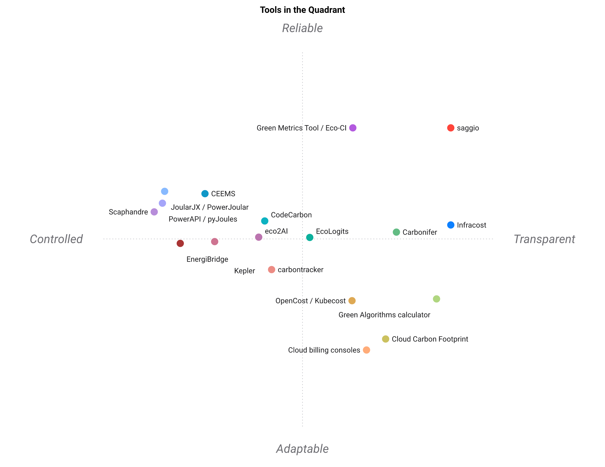

# Landscape

[🇫🇷 PAYSAGE.md](PAYSAGE.md) · 🇬🇧 English

Other tools in the "what does running this code cost" space, with the case where
each of them is the better choice. Ratings are ⭐ (1) to ⭐⭐⭐⭐⭐ (5), scored
against *this* tool's job: **a committed, reviewable, per-unit-of-work cost
model across several dimensions, where every number states how far it can be
trusted**. A tool built for a different job is not penalised for being good at
that job instead; the score says fit to this niche, nothing more.

A star is relative to the cohort in the table and to the date below it. This
page did not say so until a rating of the same shape over artificial
intelligence (AI) models — the [AI Energy Score](https://huggingface.github.io/AIEnergyScore/),
which recalibrates its own stars about twice a year — made the omission plain by
stating it in its own first lines.

Eighteen tools, ten criteria. The rows added in this round were read on
2026-10-29; the rest were last read on 2026-10-01. Projects move; if something
here is out of date, [say so](CONTRIBUTING.md).

## At a glance

| | Per-unit model | Provenance on every number | Multi-dimension | Committed artefact | Measures power | Workload, not machine | Estimates without running | Drift gate | Reports for people | Offline |
| --- | :---: | :---: | :---: | :---: | :---: | :---: | :---: | :---: | :---: | :---: |
| **saggio** | ⭐⭐⭐⭐⭐ | ⭐⭐⭐⭐⭐ | ⭐⭐⭐⭐⭐ | ⭐⭐⭐⭐⭐ | ⭐⭐⭐⭐ | ⭐⭐ | ⭐⭐⭐⭐ | ⭐⭐⭐⭐⭐ | ⭐⭐⭐⭐⭐ | ⭐⭐⭐⭐⭐ |
| CodeCarbon | ⭐⭐ | ⭐⭐ | ⭐⭐ | ⭐⭐ | ⭐⭐⭐⭐ | ⭐⭐⭐ | ⭐ | ⭐ | ⭐⭐⭐ | ⭐⭐⭐ |
| Green Algorithms calculator | ⭐⭐⭐ | ⭐⭐⭐⭐ | ⭐⭐⭐ | ⭐ | ⭐ | ⭐⭐ | ⭐⭐⭐⭐⭐ | ⭐ | ⭐⭐⭐ | ⭐ |
| Scaphandre | ⭐ | ⭐⭐ | ⭐ | ⭐ | ⭐⭐⭐⭐⭐ | ⭐⭐⭐⭐⭐ | ⭐ | ⭐ | ⭐⭐ | ⭐⭐⭐⭐⭐ |
| PowerAPI / pyJoules | ⭐⭐ | ⭐⭐ | ⭐ | ⭐ | ⭐⭐⭐⭐⭐ | ⭐⭐⭐⭐ | ⭐ | ⭐ | ⭐ | ⭐⭐⭐⭐⭐ |
| JoularJX / PowerJoular | ⭐⭐ | ⭐⭐ | ⭐ | ⭐ | ⭐⭐⭐⭐⭐ | ⭐⭐⭐⭐⭐ | ⭐ | ⭐ | ⭐⭐ | ⭐⭐⭐⭐⭐ |
| Kepler | ⭐ | ⭐⭐ | ⭐⭐ | ⭐ | ⭐⭐⭐⭐ | ⭐⭐⭐⭐ | ⭐⭐ | ⭐ | ⭐⭐ | ⭐⭐⭐⭐ |
| CEEMS | ⭐⭐ | ⭐⭐ | ⭐⭐ | ⭐ | ⭐⭐⭐⭐⭐ | ⭐⭐⭐⭐⭐ | ⭐ | ⭐ | ⭐⭐⭐ | ⭐⭐⭐⭐ |
| eco2AI | ⭐⭐ | ⭐⭐ | ⭐⭐ | ⭐⭐ | ⭐⭐⭐ | ⭐⭐⭐ | ⭐ | ⭐ | ⭐⭐ | ⭐⭐⭐ |
| carbontracker | ⭐⭐ | ⭐⭐ | ⭐⭐ | ⭐ | ⭐⭐⭐⭐ | ⭐⭐⭐ | ⭐⭐⭐ | ⭐ | ⭐⭐ | ⭐⭐ |
| EcoLogits | ⭐⭐⭐⭐ | ⭐⭐⭐ | ⭐⭐ | ⭐ | ⭐ | ⭐⭐⭐⭐ | ⭐⭐ | ⭐ | ⭐⭐ | ⭐⭐⭐ |
| EnergiBridge | ⭐ | ⭐⭐ | ⭐ | ⭐ | ⭐⭐⭐⭐⭐ | ⭐⭐ | ⭐ | ⭐ | ⭐ | ⭐⭐⭐⭐⭐ |
| Green Metrics Tool / Eco-CI | ⭐⭐⭐ | ⭐⭐⭐ | ⭐⭐ | ⭐⭐⭐ | ⭐⭐⭐⭐ | ⭐⭐⭐⭐ | ⭐⭐ | ⭐⭐⭐⭐ | ⭐⭐⭐⭐ | ⭐⭐⭐ |
| Cloud Carbon Footprint | ⭐ | ⭐⭐⭐ | ⭐⭐⭐ | ⭐ | ⭐ | ⭐⭐ | ⭐⭐⭐ | ⭐ | ⭐⭐⭐⭐ | ⭐ |
| Carbonifer | ⭐⭐ | ⭐⭐⭐ | ⭐⭐ | ⭐⭐ | ⭐ | ⭐⭐⭐ | ⭐⭐⭐⭐⭐ | ⭐⭐⭐⭐ | ⭐⭐⭐ | ⭐⭐⭐ |
| Infracost | ⭐⭐⭐ | ⭐⭐⭐ | ⭐ | ⭐⭐⭐ | ⭐ | ⭐⭐⭐ | ⭐⭐⭐⭐⭐ | ⭐⭐⭐⭐⭐ | ⭐⭐⭐⭐ | ⭐ |
| OpenCost / Kubecost | ⭐⭐ | ⭐⭐⭐ | ⭐⭐ | ⭐ | ⭐ | ⭐⭐⭐⭐ | ⭐⭐ | ⭐⭐ | ⭐⭐⭐⭐ | ⭐ |
| Cloud billing consoles | ⭐ | ⭐⭐⭐⭐ | ⭐ | ⭐ | ⭐ | ⭐⭐ | ⭐ | ⭐⭐ | ⭐⭐⭐⭐ | ⭐ |

**The new column is the sixth, and this tool is tied for last in it.** Every
other criterion asks what comes out; that one asks what the number is *of*. A
counter meters hardware, so a figure read off one carries whatever else the
machine was doing at the time. Scaphandre, JoularJX, Kepler and CEEMS separate
the workload from the machine — per process, per method, per container, per
scheduled job — and this package does not: it states the bracket and refuses to
pick inside it. The column is here because a table scoring only what this tool
is good at would not be worth drawing.

The table ranks; it does not explain. What a reader actually has to see first is
that the question has four links in a fixed order, that no tool on this page
answers all four, and that this package is weakest at exactly the link the
measurement tools exist for.

<p align="center">
  
</p>

## The map

The same table, drawn. [standpoint](https://github.com/warith-harchaoui/standpoint)
runs a principal component analysis over the ten ratings and lays every tool out
along the two directions they actually differ on, orienting the map so saggio
sits top-right. Two axes keep a little over seven tenths of what separates these
eighteen tools: 50% horizontally, 21% vertically.

The axis names are the machine's own reading of the loadings, and the two
language versions of this page do not name them alike — *Controlled ↔
Transparent* against *Autonomie ↔ Transparence* — because each was named in its
own language from the same numbers rather than translated from the other. What
the loadings say is plainer than either pair. The further **right**, the more a
tool produces sourced, committed, per-unit answers a reader can check. The
further **left**, the more it measures live power and attributes it to something
smaller than the whole machine. The further **up**, the more it both measures
and keeps what it measured, offline, on hardware you control. The further
**down**, the more it is something you point at a bill or a form.

<p align="center">
  
</p>

The distances are the table's, not an opinion: two tools sit together because
their rating rows are close. Nothing here is a second copy of those rows, which
is the mistake this repository keeps catching in its own pages:
[`assets/make_landscape_map.py`](assets/make_landscape_map.py) reads the stars
off this page, counts them, and writes the numeric table the map is drawn from.
After editing the table above, regenerate both:

```bash
python assets/make_landscape_map.py
standpoint assets/landscape.en.csv -r saggio -o assets --stem landscape --model qwen3:8b
standpoint assets/landscape.fr.csv -r saggio -o assets --stem landscape.fr --model qwen3:8b
```

Then commit the refreshed `assets/landscape.png`, `assets/landscape.svg` and the
two `landscape.yaml` files, which carry every coordinate so a placement can be
argued with rather than taken on trust.

## What this page took from the others

A landscape page that only explains why everything else fits worse is an
advertisement. This round went looking for the opposite. Six things came back:
two changed this page, one changed what it measures, two were listed as refusals
and are now built, and one is a vocabulary this package will have to learn.

The two that were built are the reason this section is worth re-reading. Both
refusals were real, and both were wider than they needed to be: each was hiding
a narrow thing that genuinely cannot be done inside a broad thing that can. The
narrow things are still refused, and they are named below.

### Taken: a rating says which cohort and which date it is against

The [AI Energy Score](https://huggingface.github.io/AIEnergyScore/) — Hugging
Face, Salesforce, Cohere and Carnegie Mellon University — rates models from one
star to five on watt-hours per thousand queries, measured across ten tasks on
one generation of accelerator, and says in its own first lines that a star is
relative to the other models on that leaderboard and that the whole scale is
recalibrated about twice a year. The star table at the top of this page has
exactly the same property and did not say so. It does now.

### Taken: the question of what the number is *of*

[Scaphandre](https://github.com/hubblo-org/scaphandre),
[JoularJX](https://github.com/joular/joularjx),
[Kepler](https://sustainable-computing.io/) and
[CEEMS](https://github.com/ceems-dev/ceems) all answer something this page was
scoring nobody on: a counter meters hardware, so whose work is the number?
JoularJX attributes power down to the Java method; CEEMS does it per scheduled
job on a supercomputer. That is the sixth column now, and this package is tied
for last in it. Before, the gap was named in prose at the bottom of this page
and scored nowhere, which is the comfortable way to carry a weakness.

### Taken, and built: a bracket instead of a point

[EcoLogits](https://github.com/genai-impact/ecologits) does not pick a number
when the model behind a closed interface has an unknown size. It returns a
`RangeValue` with a `min` and a `max`, documented as a 95% approximation
interval, with the two reasons for the spread named: unknown model size, and the
regression standing in for it.

That was listed here as refused, with a reason that turned out to be the wrong
reason. It conflated two things: *supporting* an interval, which costs nothing
to maintain, and *shipping a catalogue* of provider-specific regressions, which
is a standing commitment. Only the second one was ever the problem.

So the first one is built. A quantity may carry `low` and `high` beside its
value, and the rule that makes it worth carrying is the one the status already
had: **a derived value may not out-resolve the numbers it came from.** A carbon
figure computed from an intensity known within a fifth is not a single number,
and the validator now refuses it as an error, having walked the corners of every
input's interval through the same arrangements it already uses to recompute the
value. Wider than the inputs force is a modelling judgement and allowed;
narrower is a claim nobody earned.

[`examples/uncertainty.yaml`](examples/uncertainty.yaml) is a shipped model
doing exactly that, and taking the interval off its carbon figure makes it fail.

What stays refused is the narrow thing: a bundled table of provider energy
regressions. Those are only honest while somebody keeps them current, and that
is a maintenance commitment rather than a feature. State the bracket, or score
it — see the next section — and the machinery carries it the rest of the way.

### Taken, and built: data quality as a scored vector

Life-cycle assessment (LCA) solved the problem four statuses solve here, and
solved it with more resolution. The [ecoinvent pedigree matrix](https://doi.org/10.1007/s11367-014-0759-5)
scores every datum on named axes — how reliable the source, how complete, how
recent, how close geographically and technologically — then converts those
scores into an uncertainty factor, so a figure carries a distribution rather
than a label.

This was refused on the grounds that the conversion is empirically calibrated
against a database this package does not have. Reading the source properly took
that apart. The **transformation table is published** — Frischknecht and
Jungbluth 2004, page 46 — and so is the **formula**, on page 44. Both are now
implemented here exactly as published, and a model may score a quantity on the
five indicators and get the interval they give.

The part that genuinely is not transposable is one number: the **basic
uncertainty**, which in the source comes from a table indexed by the kind of
industrial flow. Those rows do not describe these dimensions, so it has to be
stated, and until it is, the scores produce no interval at all — which is the
same answer this package gives to a country nobody named.

**And the source handed over a refusal, which is the part worth having.** Two
cells of the published table are blank: geographical correlation at four,
further technological correlation at two. A blank is not 1.00. The matrix
defines no such mode, and a model that scores one is now an error rather than a
figure quietly given the benefit of a doubt the source never extended. That is
this package's own doctrine, met in somebody else's paper.

### Taken: say which confounder you held still

The [ML.ENERGY benchmark](https://ml.energy/leaderboard/) compares each model at
its own minimum-energy configuration, and says why in one line: to keep model
and task differences from being confounded by hardware utilisation. Its 2026
companion paper measures what that confounder is worth — accelerator
utilisation alone moves inference energy by three to five times
([arXiv:2601.22076](https://arxiv.org/abs/2601.22076)). A projection on this
page is a ratio between two datasheets, and the limits printed with it now name
what is being held still rather than leaving a reader to assume nothing is.

### A vocabulary this package will have to learn

The Green Software Foundation is drafting
[semantic conventions for carbon in OpenTelemetry](https://github.com/Green-Software-Foundation/sci-otel):
one agreed name each for energy, grid intensity, embodied carbon and the
functional unit, so that the four terms of the Software Carbon Intensity (SCI)
specification can travel as telemetry rather than as a report. This package
writes those same four under its own field names, in its own YAML (YAML Ain't
Markup Language) file. Nothing has to change yet, and something will.

## The projects

### [CodeCarbon](https://codecarbon.io/)

The best known tool in the space, and the right first choice when what you want
is a line of Python that logs the emissions of a training run while it happens.
It tracks CPU (central processing unit), GPU (graphics processing unit), and
memory through RAPL (Running Average Power Limit) and `nvidia-smi`, looks up a
regional grid intensity, then writes a CSV (comma-separated values).

Where it differs: CodeCarbon measures an *episode*. It answers "what did this
run emit", not "what does one request cost", and its output is a log rather than
a reviewed artefact. Its sampling is coarse by design, at a measured price: a
2026 study of RAPL-based tools polling at 1 kHz put CodeCarbon's own time
overhead between 5.4% and 46.8%, which is the argument for its default interval
rather than against the tool. It emits a number whether or not the inputs
justify one, which is the right call for telemetry and the wrong one for a
figure somebody will quote in a report. **Use CodeCarbon when you want passive
measurement of training runs. Use this when you want a per-unit figure you are
prepared to defend.**

### [Green Algorithms](https://www.green-algorithms.org/)

The calculator behind the method this package implements, from the
[2021 paper](https://doi.org/10.1002/advs.202100707). Excellent for a one-off
estimate of a computation that has already happened or has not happened yet, with
no instrumentation at all. Well sourced and clearly explained.

Where it differs: it is a web form, so its answer lives in a browser tab rather
than in your repository. It does not measure, compare versions, or read your
code. **Use the calculator for a quick estimate. Use this when the estimate
needs to live next to the code and be checked again next quarter.**

### [Scaphandre](https://github.com/hubblo-org/scaphandre) and [PowerAPI](https://powerapi.org/) / [pyJoules](https://github.com/powerapi-ng/pyJoules)

Serious power measurement. Scaphandre is an agent that exposes per-process power
to Prometheus; PowerAPI and pyJoules give you fine-grained RAPL readings from
Python. Both measure far better than this package does, which reads the package
counter around a bounded slice and nothing more.

Where they differ: they produce watts, not costs. There is no grid intensity, no
tariff, no unit of work, no provenance, no report. **Use Scaphandre or PowerAPI
when you need real, continuous power measurement. Feed the result into a model
like this one when you need it to mean something to a reader.**

### [JoularJX](https://github.com/joular/joularjx) and [PowerJoular](https://github.com/joular/powerjoular)

Power monitoring at the level of the source code. PowerJoular meters a process;
JoularJX is a Java agent, needing no change to the program, that reports the
power of every method the program called while it runs and the total energy of
each one when it exits. It reads RAPL through powercap on Linux, `powermetrics`
on macOS, a driver on Windows, and a fitted power model on a Raspberry Pi.

Where it differs: the finest attribution in this table, and no cost model at the
end of it. No grid intensity, no tariff, no unit of work, no status on a row.
**Use JoularJX when the question is which method is expensive.** It is also the
clearest answer to the sixth column — a figure attributed to a method is a
figure attributed to the work — which is the thing this package does not do.

### [Kepler](https://sustainable-computing.io/)

Power and carbon attribution for Kubernetes workloads, from hardware counters,
exported to Prometheus. Strong at what it does. In 2026 it rewrote its collection
to read `/proc` and `/sys` instead of eBPF (extended Berkeley Packet Filter),
dropping the `CAP_BPF` and `CAP_SYSADMIN` it used to need — the same
least-privilege direction this package takes when it prints the remedy for a
root-only counter rather than acquiring the rights to read it.

Where it differs: it is cluster infrastructure. It answers "which pods are
drawing power right now", not "what does one unit of work cost", and needs a
cluster to answer anything at all. **Use Kepler for a running fleet. Use this
for a codebase.**

### [CEEMS](https://github.com/ceems-dev/ceems)

The Compute Energy and Emissions Monitoring Stack
([arXiv:2412.07290](https://arxiv.org/abs/2412.07290)): energy and emissions per
compute job, across the SLURM (Simple Linux Utility for Resource Management)
scheduler, OpenStack and Kubernetes alike, with accelerator metrics beside the
processor ones and continuous eBPF profiling under both. It runs on the Jean Zay
supercomputer at a churn of roughly twenty-five thousand jobs a day, and the
part worth noting is that nobody submitting those jobs changed anything in order
to be measured.

Where it differs: it is a platform's instrument, installed once by whoever runs
the cluster, answering for every job on it. This is a repository's instrument,
installed by whoever wrote the code, answering for one unit of work. **Use CEEMS
when you operate the machines.** The two meet the day a computing centre wants
to tell a user what one run of their code cost, which is a sentence this package
writes and CEEMS does not.

### [eco2AI](https://github.com/sb-ai-lab/Eco2AI) and [carbontracker](https://github.com/lfwa/carbontracker)

Both are decorator-style trackers for machine-learning training, close in spirit to
CodeCarbon. `carbontracker` additionally predicts the footprint of a full run from
its first epochs, which is the same idea as this package's whole-run projection.

Where they differ: same as CodeCarbon. Episode-shaped, log-shaped, silent about
how well founded any particular figure is. **Use them for training telemetry.**

### [EcoLogits](https://github.com/genai-impact/ecologits)

Instruments calls to six generative-model providers — Anthropic, Cohere, Google
GenAI, Hugging Face Hub, Mistral AI, OpenAI — and attaches an energy figure and
a greenhouse-gas figure to each one. Mozilla Public License 2.0.

It is the one tool here that answers the same question this package asks about a
paid interface call, and it answers it better: this package prices such a call
in money, from a published tariff, and says nothing at all about its energy.

**The idea worth taking.** When the model behind a closed interface has an
unknown size, EcoLogits does not pick a number — it returns a `RangeValue` with
a `min` and a `max`, documented as a 95% approximation interval, with the
uncertainty named: unknown model size, and the regression used to stand in for
it. It is set out above, under
[what this page took from the others](#taken-and-built-a-bracket-instead-of-a-point),
with the reason it is recorded rather than built.

Where it differs: no unit of work beyond the call, no committed artefact, no
drift gate, and the figure stops at the provider's door. **Use EcoLogits when
the generative interface is the cost. Use this when it is one line of a model
that also has to account for the machine the calling code runs on.**

### [EnergiBridge](https://github.com/tdurieux/EnergiBridge)

Wraps any command and logs power, frequency, temperature, processor and graphics
use, and memory to a comma-separated-values file. Intel, AMD and M-series
processors; Linux, macOS **and Windows**. MIT licence.

It is worth naming here precisely because it reaches the platform this package
refuses. It gets there by shipping a kernel-mode driver on Windows —
LibreHardwareMonitor's — which is the answer to the question
[`MEASURING.md`](MEASURING.md) leaves open: Windows is measurable, at the price
of installing a driver. That price is the reason this package still says no
rather than half-working, and naming who pays it is more useful than repeating
that it cannot be done.

Where it differs: it produces a trace, not a model. No grid intensity, no
tariff, no unit of work, no provenance on a row, no report. **Use EnergiBridge
to get a power trace on a machine this package will not read. Feed what it
measured into a model here when the trace has to mean something to a reader.**

### [Green Metrics Tool](https://github.com/green-coding-solutions/green-metrics-tool) and [Eco-CI](https://github.com/green-coding-solutions/eco-ci-energy-estimation)

The nearest neighbour in the table above, and the one that spent this page's
first draft in the wrong half of it. Green Metrics Tool measures the energy and
carbon of a software run described as configuration in a file, then *publishes*
what it measured. Eco-CI is the half that lives inside a pipeline, and it
answers with an estimate exactly where this package answers with a refusal: on a
hosted runner where no energy counter can be read, it estimates from processor
use against a fitted power curve, and labels the result an estimate.

Where it differs: the artefact is a published run rather than a committed model.
It will tell you what this build drew, with its own caveat printed beside it,
and it will not tell you what one request of the resulting service costs, nor
hold a figure open where an input is missing. **Use Green Metrics Tool when the
thing to watch is a build, and when the measurement should be public.** What it
publishes is described further down, under
[where the field publishes its measurements](#where-the-field-publishes-its-measurements):
it is the most complete public evidence base this field has.

### [Cloud Carbon Footprint](https://www.cloudcarbonfootprint.org/)

Reads your cloud billing data and estimates emissions from it, with a good
dashboard and a published, defensible methodology.

Where it differs: it starts from the bill, so it can only describe what you have
already spent, at account granularity. It cannot tell you what one inference
costs, nor anything at all before you have run the thing. **Use it for
organisational reporting on cloud spend. Use this for engineering decisions
about a codebase.**

### [Infracost](https://www.infracost.io/)

The closest thing in spirit to this project, in a different domain. It reads
Terraform, estimates what the infrastructure will cost before it is applied,
then comments the difference on your pull request. The drift gate here is the
same idea.

Where it differs: Infracost prices declared infrastructure, not executed code.
It is money-only, answering "what will this stack cost per month", not "what
does one unit of work cost across five dimensions". **Use Infracost for
infrastructure as code. The two answer different halves of the same question and
sit happily side by side.**

### [Carbonifer](https://github.com/carboniferio/carbonifer)

Infracost's carbon sibling, and a demonstration that the shape generalises:
`carbonifer plan` reads the same Terraform files and estimates the emissions of
infrastructure that does not exist yet, so a region or an instance size can be
argued about before anything is provisioned.

Where it differs: the same boundary as Infracost. It prices declared
infrastructure rather than executed code, and its unit is a machine-hour rather
than a unit of work. **Use Carbonifer to compare two plans.** The pair of them
is the clearest evidence in this table that the drift gate here is not an
original idea: it is their idea, pointed at a repository instead of a plan.

### [FOCUS](https://focus.finops.org/) and unit economics

Not a tool, and not scored: a schema and a vocabulary. The FinOps Open Cost and
Usage Specification normalises billing data across providers — version 1.4 was
ratified in June 2026 — and the FinOps Foundation's framework names, from the
money side, the primitive this package is built on: a unit cost is an attributed
cost divided by a business metric, a cost per customer, per transaction, per
successful output.

Where it differs: it standardises the numerator, which is the bill, and leaves
the denominator to you. The denominator is this package's whole difficulty —
what one unit of work *is*, and how many of them a run performed — and it is the
part nobody else can hand you. **Read FOCUS when several bills have to be
compared.** The two halves fit together.

### [OpenCost](https://www.opencost.io/) and Kubecost

Real-time cost allocation for Kubernetes, by namespace, workload and label. The
standard answer for "which team is spending what" on a cluster.

Where it differs: allocation of an incurred bill, not a model of a unit of work.
Money-first, with carbon added on. **Use OpenCost for chargeback.**

### Cloud billing consoles

AWS (Amazon Web Services) Cost Explorer, GCP (Google Cloud Platform) Billing, Azure Cost Management. Authoritative on what you
were charged, which is exactly one dimension of one question, after the fact.
**Use them when the question is "why was the bill that size".**

## The other side of the room: what a sustainability team already has

The tools above answer an engineering question. The people who have to *file* a
carbon figure use a different set entirely, none of which appears in the table
at the top of this page — deliberately, because scoring them against this tool's
niche would be an unflattering comparison on a question they are not trying to
answer.

### Corporate carbon accounting platforms

[Normative](https://normative.io/), [Greenly](https://greenly.earth/),
[Sweep](https://www.sweep.net/), [Persefoni](https://www.persefoni.com/) and
[Watershed](https://watershed.com/) are the system of record for a whole
organisation's inventory: every scope, every category, the double-materiality
workflow, in several cases the tagged filing itself.

Where they differ: none of them reads your code. The figure for a piece of
software is an *input* they cannot produce; what reaches them instead is usually
a cloud bill divided by something. **Use them to file. Use this to produce the
software line they are missing** — [`INVENTORY.md`](INVENTORY.md) says which
line that is.

### Where the field publishes its measurements

Not tools to choose between, and mostly not scored above: these are the places
this field puts its *evidence*, worth knowing because they set what a reader
expects a page of numbers to carry. Read 2026-10-18.

**[Green Metrics Tool](https://github.com/green-coding-solutions/green-metrics-tool) and [Energy-ID](https://www.green-coding.io/products/energy-id/)**, by
Green Coding Solutions, scored in the table above and described there as a tool.
What it *publishes* belongs here: per-run
[statistics pages](https://metrics.green-coding.io/), timeline views that track
a project across commits, comparison views, a public API (application
programming interface), and CI (continuous integration) badges. Energy-ID is the
database beside it, benchmarking open-source software, CLI (command-line
interface) tooling and language primitives on fixed machines and publishing a
scorecard per task, each stating the machine and carrying the caveat in its own
words: *"absolute numbers shown here are not to be taken as ground truth."* It
is the most complete public evidence base in this field, and the closest thing
to a gallery any of these tools has.

**[The ML.ENERGY Leaderboard](https://ml.energy/leaderboard/)** — machine learning (ML) energy —
by the ML.ENERGY Initiative at Michigan ([arXiv:2505.06371](https://arxiv.org/abs/2505.06371)).
Inference energy for generative models, measured rather than modelled: version
3.0 reports 46 models across 7 tasks, 1,858 configurations on NVIDIA H100 and
B200. What makes its rows comparable is what it holds constant — it compares
each model's *minimum-energy configuration*, which it says is to focus on model
and task differences "without being confounded by hardware utilization
differences". A result worth carrying away from it: reasoning tasks cost about
**twenty-five times** the energy per response of ordinary text conversation,
which is a far larger term than anything a code-reading tool can see.

Its 2026 companion paper, [*Where Do the Joules Go?*](https://arxiv.org/abs/2601.22076),
measures the confounder the leaderboard holds still: accelerator utilisation
alone moves inference energy by three to five times across the same 1,858
configurations, and a video is sometimes more than a hundred times an image.
Two of those three terms are invisible to any tool that reads a repository.

**[The AI Energy Score](https://huggingface.github.io/AIEnergyScore/)**, by
Hugging Face, Salesforce, Cohere and Carnegie Mellon University. The same star
shape as the table at the top of this page, over models rather than tools: ten
general-domain tasks, energy measured on one generation of accelerator, reported
as watt-hours per thousand queries, a one-to-five rating, and a leaderboard
covering 166 models. Two of its decisions are worth copying by anyone who
publishes a rating at all. The stars are explicitly relative to the cohort being
rated, so nobody can quote one as an absolute. And the recalibration runs on a
stated schedule, about twice a year, which is the only honest way to keep a
comparative scale while the field keeps moving under it.

**[The Green Software Foundation's Software Carbon Intensity (SCI) case studies](https://sci-guide.greensoftware.foundation/CaseStudies/)**.
Eleven published, from CAST, UBS, NTT DATA, Microsoft, AFAS and others, each a
filed SCI figure for a real application. The index carries the organisation, a
sentence and a link; the figure, the functional unit and the boundary are inside
the linked document. It is the reference catalogue for *what a filed number
looks like*, which is a different question from which tool produced it.

### The standards moved twice while this was being written

Both of these sit upstream of every tool in the table, and neither is a tool.

**[SCI for AI](https://greensoftware.foundation/standards/sci-ai/) was ratified
in December 2025.** It extends the Software Carbon Intensity methodology —
already an International Organization for Standardization (ISO) and
International Electrotechnical Commission (IEC) standard, ISO/IEC 21031:2024 —
over the lifecycle of an artificial-intelligence system: location-specific grid
intensity, embodied hardware emissions, a standardised functional unit so two
systems can be compared, and no offsets. Those are the four terms this package
computes; [`STANDARDS.md`](STANDARDS.md) says where it conforms and where it
deliberately does not.

**Carbon is being proposed as a first-class OpenTelemetry signal.** The Green
Software Foundation's [sci-otel](https://github.com/Green-Software-Foundation/sci-otel)
work drafts semantic conventions for energy, carbon intensity, embodied carbon
and the functional unit, and hands the blueprint to OpenTelemetry's own
specification group. If it lands, this field gets one vocabulary and the field
names in this package's YAML become a dialect of it.

### [Electricity Maps](https://www.electricitymaps.com/) and [WattTime](https://watttime.org/)

Where a grid intensity comes from. WattTime publishes a *marginal* signal — the
emissions of the generator that answers one more unit of demand — at five-minute
resolution. Electricity Maps publishes an *average* signal, hourly, and in 2025
**withdrew its own marginal offering**, saying publicly that it could not stand
behind the veracity and verifiability of such a signal.

That withdrawal is the most useful thing on this page for anyone building a tool
like this one. A vendor took a product off the market because it could not
defend the number, which is the same move this package makes when it writes
`TODO` instead of a plausible figure, at a very much smaller scale. The
catalogue here carries average intensities and says which they are.

### [Carbonlog](https://www.cnaught.com/blog/how-to-actually-measure-the-carbon-footprint-of-ai-code)

Launched in March 2026 by CNaught: a plugin that tracks the energy and emissions
of an assistant-written coding session as it happens, broken down by model and
by project, computed from the published per-prompt figures of
[Jegham and colleagues](https://arxiv.org/abs/2505.09598) rather than from a
counter — there is no counter to read, because the inference happened on
somebody else's machine.

It is here because it meters the one cost this package structurally cannot see:
not what your code costs to run, but what it cost to write. Both are real, and
nothing in this table adds them together.

### [Boavizta](https://boavizta.org/en/tools)

An association publishing open data and open tools for the environmental impact
of digital equipment: `BoaviztAPI` for equipment and cloud instances, `Datavizta`
to explore the manufacturers' footprints, `cloud-scanner` to read real AWS usage,
`e-footprint` to model a whole digital service. Multi-criteria rather than carbon
alone — primary energy and abiotic resource depletion beside the global warming
potential.

This package already depends on them: the four processor footprints in the
catalogue are computed by `BoaviztAPI`, whose GPU half is **refused by name**
because it answers with one archetype for every card. Both the use and the
refusal are set out in [`STANDARDS.md`](STANDARDS.md).

Where they differ: Boavizta models an inventory of *equipment* — this many
instances, for this long. This models a *unit of work from a repository*. The two
meet in the middle and neither replaces the other. **Use Boavizta to put a
footprint on a fleet. Use this to put one on a request.**

### [Impact Framework](https://if.greensoftware.foundation/)

The Green Software Foundation's manifest-driven pipeline: plugins convert
observable metrics into environmental impacts, which makes it the vehicle the
SCI specification is usually implemented through.

Where it differs: it is a computation graph you configure, not a committed
artefact carrying a provenance contract. A manifest says how a figure was
computed; it does not refuse to produce one when the inputs do not justify it.
**Use IF to compose a pipeline across several tools. Use this when the output has
to be defended.**

### [Climatiq](https://www.climatiq.io/)

An emission-factor API: send activity data, receive emissions, against a
maintained factor database.

Where it differs: it answers *what is the factor*, not *what did this code do*.
It sits upstream of a tool like this one rather than beside it.

## Where this one is weakest

Being honest about the gaps, since that is the whole premise of the tool.

- **The costs still price the machine, not the process.** Every counter here
  meters *hardware*, so the wattage a cost model carries includes the browser
  beside the run. Two separations are now recorded next to it — the idle floor
  the machine was drawing beforehand, the run's share of the machine's processor
  time applied to the processor's own counter — and a measured model states both
  in the sentence attached to its power figure. What has not changed is which
  number the costs use: the whole one. Scaphandre, PowerAPI, Kepler and CEEMS go
  further and model a per-process, per-container and per-job draw, and JoularJX
  goes further still and attributes power to a method; this package records the
  bracket and refuses to pick inside it. On a shared box that is still the gap
  that matters most, which is why it is now the sixth column of the table above
  rather than a sentence down here.
- **Two platforms, not three.** Linux and macOS, both reading real counters —
  powercap zones by name, `IOReport` on Apple Silicon, NVML (NVIDIA Management Library) and the `amdgpu` /
  `i915` / `xe` sysfs interfaces for the accelerator. Windows is out of scope
  rather than unfinished: it offers no unprivileged processor energy counter, no
  machine-wide processor-time total, and no POSIX (Portable Operating System Interface) resource accounting, so every
  figure there would be an estimate. Narrower than the tools above it in this
  table, and narrow on purpose — but the purpose is contestable, and Eco-CI
  contests it: on a hosted runner with no readable counter it estimates from
  processor use against a fitted power curve and labels the answer an estimate,
  which is a defensible thing to do with a vocabulary that has a word for
  `estimated`. The refusal here stands on a narrower claim: an estimate is
  honest when the model behind it is published and fitted to the machine, and
  no such model has been fitted for the Windows machines this package would
  meet.
- **A counter is not the wall.** Fans, storage, network and the power supply sit
  outside RAPL and NVML by construction, and the gap is not a constant that could
  be added back: measured against physical meters it is a slope of about 1.17,
  varying per node. Every figure here is the scope it names, never the machine.
- **No continuous monitoring.** One bounded slice, once. If you want a time series,
  this is the wrong shape of tool.
- **Embodied carbon is implemented and barely catalogued.** The arithmetic is
  there — the four terms of the International Organization for Standardization
  and International Electrotechnical Commission's joint standard, ISO/IEC 21031,
  amortised over calendar time — and so
  are eight footprints: four accelerators out of 25 rows and four processors out
  of 12. Everything else reports `TODO`. The lifetime is still yours to state,
  because how long a card stays in service is a fact about a fleet rather than
  about a part. See [`STANDARDS.md`](STANDARDS.md) for the table and the eight
  refusals.
- **The catalogues are small.** They cover the common accelerators and the larger
  grids. Beyond that you will meet a miss, and the tool will tell you which row to
  add.
- **Projection between machines is a datasheet ratio.** Peak throughput is not a
  benchmark. Real speedups are smaller, and the projection says so in its limits
  rather than in a footnote.

## Where it is worth choosing

When the number has to survive being questioned. When somebody is going to put a
per-request carbon figure in a customer-facing document, or a per-run cost in a
budget, then is asked six months later where it came from. That is the case
these tools mostly do not serve: they produce numbers; this one produces numbers
that come with their own audit trail and refuse to exist when they would have to
be invented.

It is also the only tool in this table that will *measure how the cost grows
with the size of the job*: three slices of different sizes, a fitted exponent, a
goodness of fit, a refusal to project at all when the fit says the slices are
not measuring one consistent behaviour. Every other tool here projects by the
ratio of sizes, or does not project.
